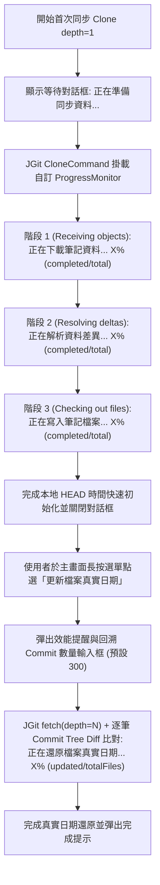

## MODIFIED Requirements

### Requirement: GraphQL 單次批次 Commit 時間同步
在淺層下載（`depth = 1`）的前提下，首次拉取（Clone）與日常同步（Pull）MUST 僅執行快速的本地 `HEAD` 時間初始化以確保極速同步體驗；當使用者需要還原歷史真實修改時間時，系統 MUST 在主畫面長按選單提供【更新檔案真實日期】功能，先彈出效能影響提醒與可自訂回溯 Commit 數量輸入框（預設 `300` 筆），確認後透過 JGit `fetch(depth = N)` 與本地 Commit Tree Diff 比對更新各檔案 `setLastModified(epochMilli)`，並於等待對話框即時顯示進度百分比與完成數量。

#### Scenario: 筆記檔案時間校正
- **WHEN** GitHub 筆記 Clone 完成
- **THEN** 系統先以 `depth = 1` 最新 Commit 時間快速完成初始化並顯示於主畫面

#### Scenario: 長按選單手動觸發自訂 Commit 數量之檔案真實日期更新
- **WHEN** 使用者在主畫面長按遠端筆記並點選「更新檔案真實日期」，確認效能提醒並輸入回溯 Commit 數量（預設 300）
- **THEN** 系統擷取最近 N 筆 Commit 並由新到舊比對檔案異動以更新真實修改日期，期間於等待對話框即時顯示處理進度，完成後關閉對話框並提示成功

## ADDED Requirements

### Requirement: 首次同步 (Clone) 與檔案真實日期還原即時進度回報
系統在執行首次下載（Clone `depth = 1`）與手動更新檔案真實日期時，MUST 移除固定計時輪播文字，改透過 JGit `ProgressMonitor` 與 Commit 比對回呼，即時於等待對話框（及主畫面複製中狀態）呈現真實同步進度：
1. **下載資料階段 (`Receiving objects`)**：顯示進度百分比與物件進度（`已完成/總物件數`），不顯示不準確之 `0 B` 容量。
2. **解析差異階段 (`Resolving deltas`)**：顯示進度百分比與完成數量（`已完成/總數`）。
3. **寫入檔案階段 (`Checking out files`)**：顯示進度百分比與檔案數量（`已完成/總檔案數`）。
4. **真實日期還原階段 (`SyncFileDates`)**：於長按選單觸發時，顯示比對最近 N 筆 Commit 還原檔案真實修改日期之進度百分比與檔案數量（`已完成/總檔案數`）。

#### Scenario: 首次同步大容量儲存庫時即時顯示下載物件進度
- **WHEN** 使用者首次下載包含大量筆記與附件的遠端儲存庫
- **THEN** 等待對話框即時更新顯示目前下載百分比與已接收物件數（例如 `正在下載筆記資料... 42% (210/500)`），不再以固定秒數盲目輪播文字或顯示 `0 B`

#### Scenario: 長按觸發檔案真實日期還原時顯示即時進度
- **WHEN** 使用者於主畫面長按選單點選「更新檔案真實日期」並確認回溯 Commit 數量（預設 300）
- **THEN** 等待對話框即時顯示遠端歷史拉取進度與「正在還原檔案真實日期... X% (已處理檔案數/總檔案數)」，直到全數還原完畢才關閉對話框
