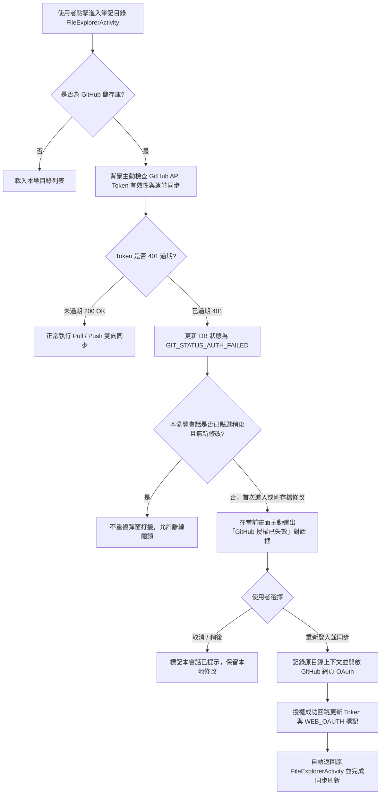

## ADDED Requirements

### Requirement: 資料庫明確記錄 GitHub 網頁認證類型與無損遷移
系統 MUST 在本地 SQLite `REMOTE_GIT` 資料表中維護 `AUTH_TYPE` 欄位，明確區分該儲存庫是否透過「GitHub 網頁認證（`WEB_OAUTH`）」或「一般密碼/個人存取權杖（`PASSWORD`）」建立；於資料庫版本升級時 MUST 採用 `ALTER TABLE` 無損升級，並自動將既有非 PAT 之 GitHub 儲存庫標記為 `WEB_OAUTH`。

#### Scenario: 資料庫升級自動保留資料並標記既有網頁認證儲存庫
- **WHEN** 使用者將 App 更新至包含資料庫 v3 之版本並啟動應用程式
- **THEN** 系統透過 `ALTER TABLE` 新增 `AUTH_TYPE` 欄位而不刪除任何既有儲存庫紀錄，並將既有 `github.com` 且非 `ghp_` / `github_pat_` 開頭之儲存庫自動標記為 `WEB_OAUTH`

#### Scenario: 透過網頁 OAuth 建立或重新授權時標記為 WEB_OAUTH
- **WHEN** 使用者透過 GitHub 網頁 OAuth 建立新筆記或重新取得授權
- **THEN** 系統將該筆 `RemoteGit` 紀錄的 `auth_type` 設為 `WEB_OAUTH` 並寫入資料庫

### Requirement: 進入筆記與編輯存檔時主動檢查網頁認證過期並引導重獲授權
當使用者點擊進入筆記目錄（`FileExplorerActivity`）或於筆記內編輯存檔觸發同步時，系統 MUST 主動檢查該儲存庫是否為 GitHub 網頁認證且 Token 已過期（401 Unauthorized）；若已過期，系統 MUST 立即在當前畫面彈出對話框主動告知並引導重新取得網頁認證，且於授權完成後自動返回原筆記目錄完成同步。

#### Scenario: 點擊進入已過期的網頁認證筆記時主動彈窗
- **WHEN** 使用者在主畫面點擊進入一個使用 GitHub 網頁認證（`WEB_OAUTH`）的筆記目錄，且該 Token 已過期（回傳 401）
- **THEN** 系統即使在 Public 儲存庫或自動同步冷卻期間，仍主動偵測出 401 過期並在 `FileExplorerActivity` 彈出「GitHub 授權已失效」對話框引導重新授權

#### Scenario: 點選稍後閱讀文章不重複打擾、存檔修改時再次提醒
- **WHEN** 使用者在進入筆記目錄時對過期對話框點選「取消」，接著點開文章僅閱讀後按返回回到目錄
- **THEN** 系統在同一次目錄瀏覽會話中不再重複彈窗；但若使用者編輯文章並存檔（觸發推送失敗）或退回主畫面重新進入該筆記，系統立即再次彈出重新授權提醒

#### Scenario: 在筆記目錄完成重新授權後自動回到原目錄
- **WHEN** 使用者在 `FileExplorerActivity` 的過期提醒視窗中點擊【重新登入並同步】並完成網頁授權
- **THEN** 系統自動更新 Token、執行同步，並自動跳轉回原本正在瀏覽的 `FileExplorerActivity` 目錄畫面

### Requirement: 主畫面清單顯示授權過期狀態提示
當儲存庫狀態為 `GIT_STATUS_AUTH_FAILED` (-5) 時，主畫面（`MainActivity` / `GitList`）MUST 以醒目警告色標示該儲存庫為授權已過期狀態。

#### Scenario: 主畫面標示授權過期之筆記
- **WHEN** 某個 GitHub 筆記被偵測到認證過期（狀態碼 `-5`）且使用者查看主畫面清單
- **THEN** 該筆記項目以醒目顏色顯示名稱並附加「(授權已過期)」提示文字
