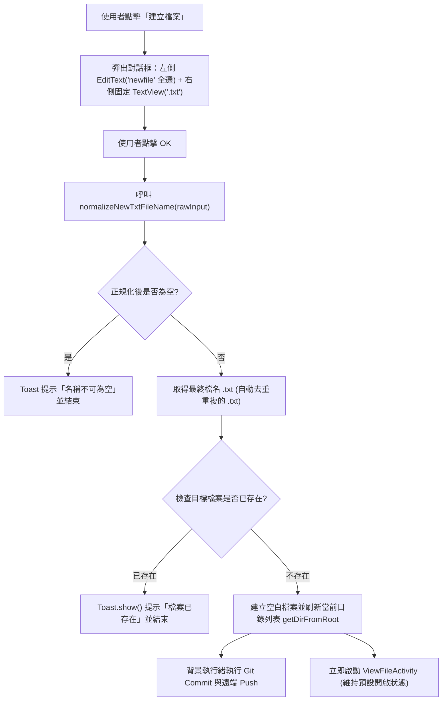
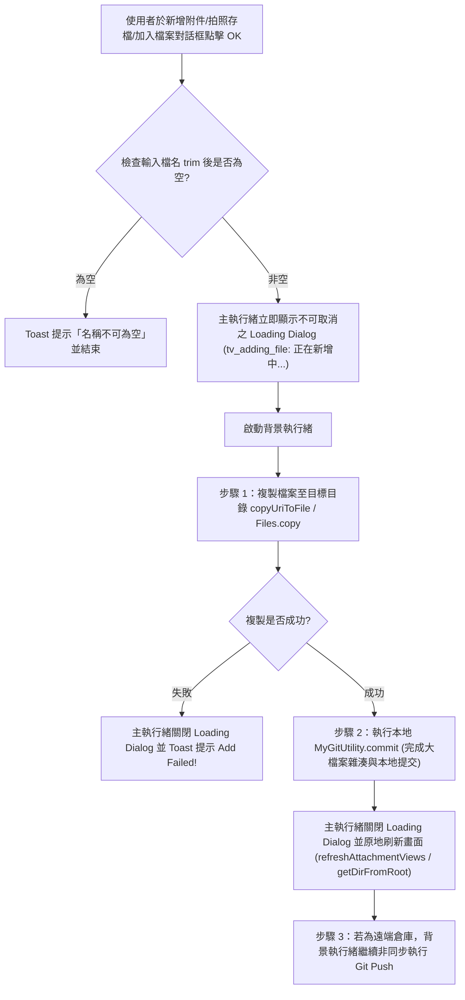

# Design: 建立檔案固定副檔名、自動開啟與新增文件等待提示設計

## Context
在 `FileExplorerActivity` 與 `ViewFileActivity` 中，建立新筆記檔案與匯入外部大檔案（附件/文件/照片）是最核心的日常操作。本次設計針對這三個流程進行防呆與回饋強化。

## Architecture & Flowcharts

### 1. 建立檔案固定 `.txt` 與自動開啟流程 (`FileExplorerActivity`)

### 2. 新增文件/附件顯示「正在新增中...」與原地刷新流程 (`ViewFileActivity` & `FileExplorerActivity`)

## Key Decisions
1. **檔名正規化純函式 (`normalizeNewTxtFileName`)**：
   - 抽離為 `public static String normalizeNewTxtFileName(String rawInput)` 方法：
     - `null` 或 `.trim()` 後為空（或僅輸入 `".txt"`）時回傳 `""`（空字串，觸發空值阻擋）。
     - 若輸入結尾已為 `.txt`（不分大小寫，如 `note.TXT`），剝除尾端 `.txt` 後若主檔名為空則回傳 `""`，否則統一加上小寫 `".txt"`。
     - 一般輸入（如 `"newfile"`）直接回傳 `"newfile.txt"`。
2. **Loading Dialog 涵蓋範圍**：
   - 涵蓋「檔案複製 + 本地 Git Commit」，避免大檔案在 JGit 計算 Object Hash 與鎖定 `.git/index.lock` 期間使用者又觸發其他 Git 操作造成衝突；而耗時受網路影響的 `Git Push` 則在關閉視窗後於背景繼續執行。
3. **原地刷新附件列 (`refreshAttachmentViews()`)**：
   - 將 `ViewFileActivity.onCreate()` 內掃描 `<file>_attach` 目錄並動態建立 `layoutAttachment` 子元件的邏輯抽取為 `refreshAttachmentViews()`，在新增附件或拍照完成時直接於 UI 執行緒更新附件列，不再呼叫 `finish(); startActivity(getIntent());` 重啟 Activity，避免畫面閃爍與編輯狀態遺失。
