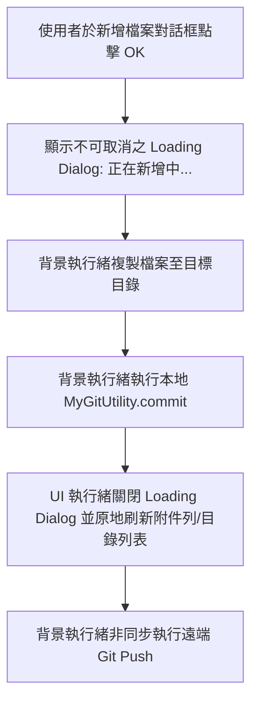

# attachment-details Delta Specification

## ADDED Requirements

### Requirement: 新增文件與附件時顯示等待視窗與原地刷新
當使用者在筆記檢視畫面 (`ViewFileActivity`) 執行「新增附件」、「拍照存檔」，或在筆記本目錄 (`FileExplorerActivity`) 執行「加入檔案」並點擊確定時，系統 MUST 立即顯示不可誤觸取消的等待視窗（顯示多語系「正在新增中...」），待背景完成「檔案複製 + 本地 Git Commit」後自動關閉等待視窗並原地刷新畫面，遠端網路 Push 則於背景非同步完成。

#### Scenario: 在筆記內新增大檔案附件時顯示正在新增中並原地更新附件列
- **WHEN** 使用者在 `ViewFileActivity` 選取檔案或拍照後於檔名對話框點擊 OK
- **THEN** 畫面立即顯示「正在新增中...」等待視窗，在完成檔案複製與本地 Git Commit 後關閉視窗並原地刷新底部附件列（不重啟 Activity），遠端 Push 在背景繼續執行

#### Scenario: 在筆記本目錄加入外部大檔案時顯示正在新增中
- **WHEN** 使用者在 `FileExplorerActivity` 選取外部檔案並於檔名對話框點擊 OK
- **THEN** 畫面立即顯示「正在新增中...」等待視窗，在完成檔案複製與本地 Git Commit 後關閉視窗並刷新目錄列表，遠端 Push 在背景繼續執行
