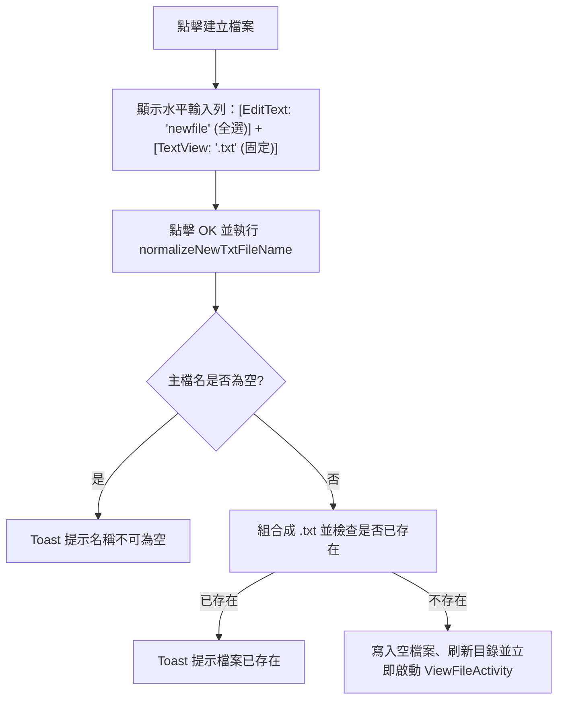

# input-sanitization Delta Specification

## ADDED Requirements

### Requirement: 建立檔案固定 .txt 副檔名與自動開啟
在筆記本目錄 (`FileExplorerActivity`) 點選「建立檔案」時，系統 MUST 將輸入框預設值設為小寫 `"newfile"` 並自動全選文字，右側搭配不可修改的固定標籤 `".txt"`；按下確定且建立成功後，系統 MUST 立即啟動 `ViewFileActivity` 開啟該新建檔案（維持預設開啟狀態）。

#### Scenario: 開窗預設顯示小寫 newfile 與固定 .txt 並自動開啟
- **WHEN** 使用者在筆記本目錄點選「建立檔案」並直接按下 OK
- **THEN** 對話框預設顯示全選之 `"newfile"` 與右側固定之 `".txt"`，建立 `"newfile.txt"` 成功後立即開啟 `ViewFileActivity` 檢視該檔案

#### Scenario: 使用者自行輸入重複的 .txt 副檔名時自動去重
- **WHEN** 使用者在建立檔案輸入框輸入 `"mynote.txt"` 或 `"  mynote.TXT  "` 並按下 OK
- **THEN** 系統自動過濾空白並去重為 `"mynote.txt"`，不會產生 `"mynote.txt.txt"`
